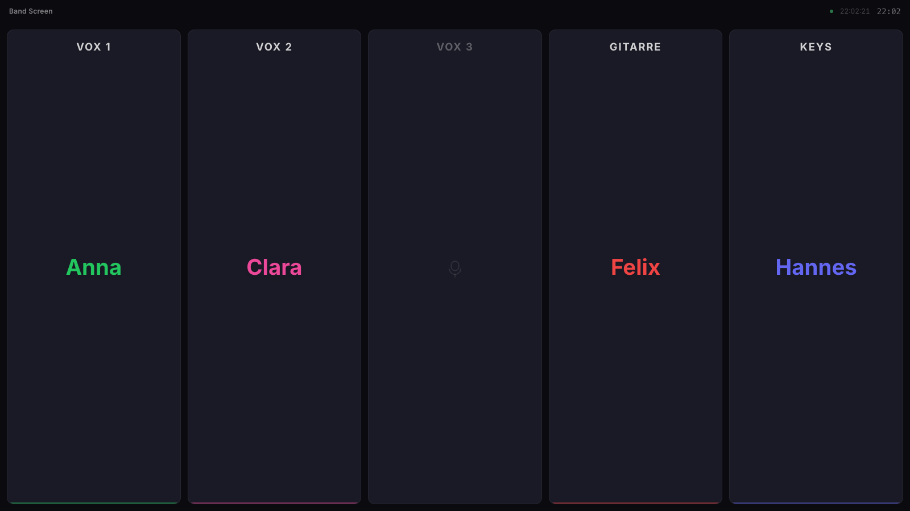
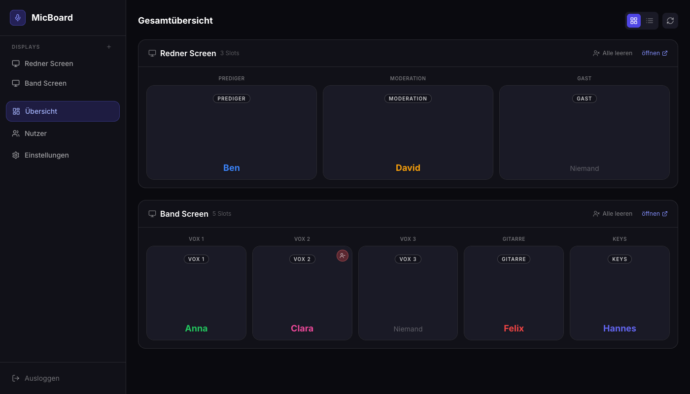

# MicBoard

[English](README.md) · **Deutsch**

**Wer ist auf welchem Mikro?** MicBoard zeigt es live auf jedem Bildschirm oder als OBS-Browserquelle. Ein Volunteer weist im Admin-Bereich Personen den Mikros zu, alle Anzeigen sind innerhalb einer Sekunde aktuell. Gebaut für unsere Gemeinde, jeden Sonntag im Einsatz.

**👉 Demo ausprobieren: [micboard.flotech.dev](https://micboard.flotech.dev)** (Passwort `demo`, wird jede Nacht zurückgesetzt)



[](https://ko-fi.com/floslist)

## Was es kann
- **Live-Abgleich:** Zuweisungen erscheinen auf allen Anzeigen in unter einer Sekunde, im Admin-Bereich sofort
- **Mehrere Anzeigen:** Redner-Screen, Band-Screen, Livestream-Szene, jede mit eigenen Plätzen (Prediger, Vox 1, Gitarre …) und Seitenverhältnis (16:9, 21:9, 32:9)
- **Fotos** pro Person, mit Ausschnitt und Zoom
- **Schnell anlegen:** Gäste direkt beim Zuweisen anlegen, sie verschwinden wieder, wenn sie nirgends mehr eingeteilt sind
- **Selbst betrieben:** deine Daten bleiben auf deinem Server. Keine Konten, keine Cloud-Dienste, keine Geheimnisse beim Bauen
- **Läuft überall:** auf jedem PHP-Webspace, einem Raspberry Pi oder einem Desktop-Rechner



## Installieren

**micboard.zip** aus dem [neuesten Release](https://github.com/Floslis/micboard/releases/latest) herunterladen und entpacken. Dann eins davon:

### A) PHP-Webspace (jeder Hoster mit PHP 7.4+)
1. Inhalt des Ordners per FTP/SFTP hochladen, z. B. nach `micboard/`
2. Adresse im Browser öffnen und das Admin-Passwort festlegen
3. Fertig. Daten liegen in `daten/` (per `.htaccess` gesperrt), Fotos in `images/`

### B) Raspberry Pi oder Desktop (Node.js 18+)
```sh
cd micboard
node server.mjs            # → http://<dieser-rechner>:8080
PORT=80 node server.mjs    # anderer Port
```
Auf dem Raspberry Pi als Dienst, damit es beim Hochfahren startet: die Vorlage `micboard.service` steht in der [englischen Anleitung](README.md#b-raspberry-pi-or-desktop-nodejs-18), dann `sudo systemctl enable --now micboard`.

### Anzeigen
Auf dem Bildschirm `https://deine-adresse/#/display/<id>` öffnen oder als OBS-Browserquelle einbinden. Den Link zu jeder Anzeige zeigt der Admin-Bereich.

## Wie es funktioniert
- React-App (Vite, Tailwind) spricht mit einem winzigen Server: `api/index.php` auf dem Webspace oder `server.mjs` mit Node. Beide bieten dieselbe Schnittstelle und speichern alles in JSON-Dateien
- Anzeigen fragen jede Sekunde, ob sich etwas geändert hat. Die Antwort ist wenige Bytes groß, solange nichts passiert
- Das Admin-Passwort liegt nur als Hash vor. Nach dem Anmelden bekommt der Browser einen Schlüssel für 30 Tage
- Demo-Modus: liegt `demo/db.json` neben der App, ist das Passwort `demo` und die Daten werden jede Nacht zurückgesetzt

## Entwickeln
```sh
npm install
npm run server   # Schnittstelle auf :8080 (Daten in .dev/)
npm run dev      # App auf :5173, leitet /api an :8080 weiter
```
Umzug von der alten Firebase-Fassung: `werkzeuge/umzug-firebase.py`.

## Lizenz
[MIT](LICENSE) · Ein Projekt von **[FLOTECH](https://flotech.dev)**
